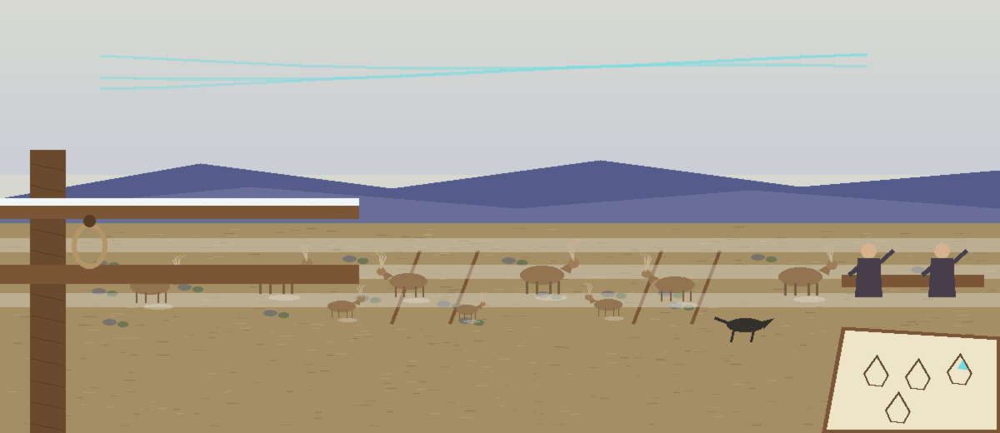
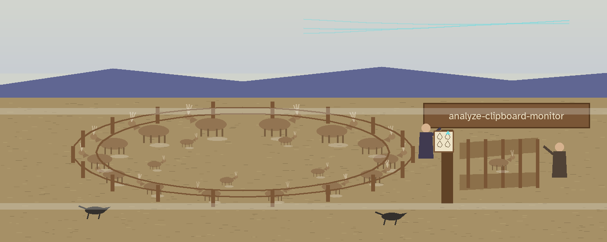
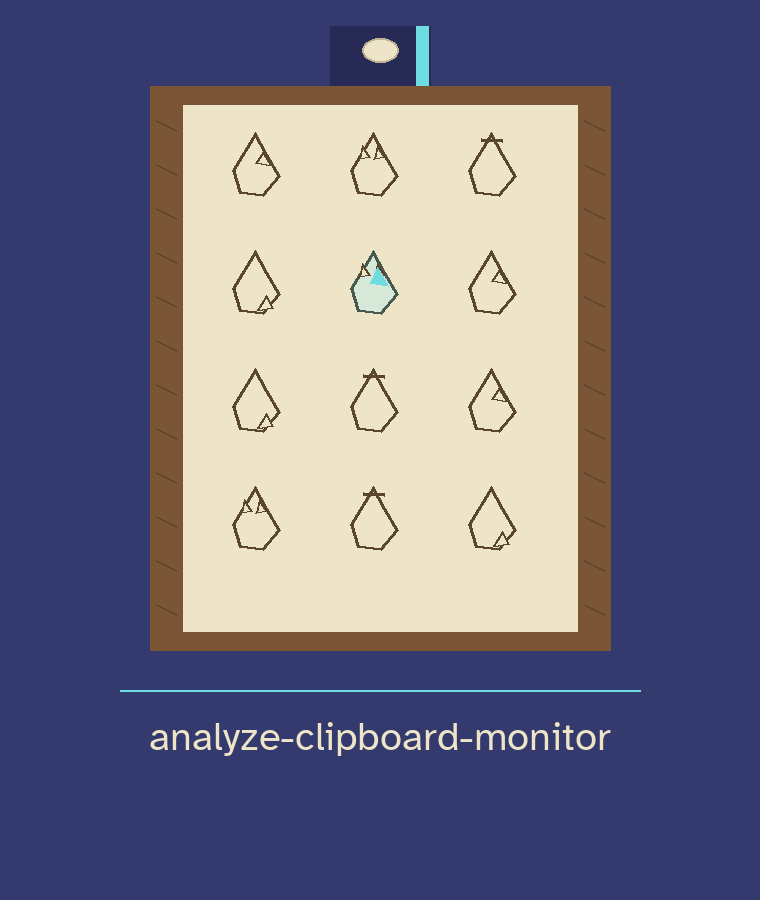

# analyze-clipboard-monitor






Monitors the system clipboard for sensitive data shapes (credit card numbers, API keys, email addresses) and alerts the user when one appears: it logs a warning and prints an `Alert!` line. It polls the clipboard once per second and runs until Ctrl+C. Detection is shape only: the card pattern checks 13 to 16 digits with optional separators and does not run a Luhn check, so innocent long numbers can trip it. An alert is a prompt to look, not a verdict.

> **Tally slate, A Shape Is Not a Verdict:** detection is shape only, the card pattern checks 13 to 16 digits with optional separators and does not run a Luhn check, so innocent long numbers can trip it. An alert is a prompt to look, not a verdict.


## Install

```
git clone https://github.com/ShadowGuard-AI/analyze-clipboard-monitor
cd analyze-clipboard-monitor
pip install -r requirements.txt
```

The only dependency is `pyperclip` (see `requirements.txt`). On Linux a clipboard backend such as xclip or xsel is also needed for pyperclip to reach the clipboard.

> **Tally slate, the Linux backend:** on Linux a clipboard backend such as xclip or xsel is also needed for pyperclip to reach the clipboard.


## Usage

```
python3 main.py [--log-level LEVEL]
```

- `--log-level`: one of DEBUG, INFO, WARNING, ERROR, CRITICAL (default: INFO)
- `-h` / `--help`: show help and exit

If pyperclip is not installed, the tool prints an install message and exits 1 before monitoring starts.

> **Tally slate, The Chart Is Missing: Install pyperclip:** if pyperclip is not installed, the tool prints an install message and exits 1 before monitoring starts.


## License

Copyright (c) ShadowGuard-AI
